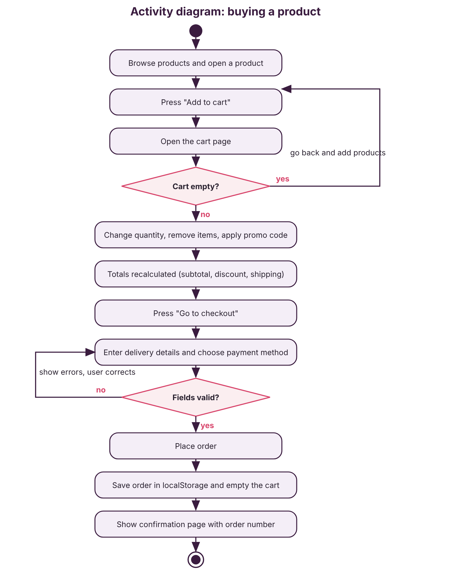
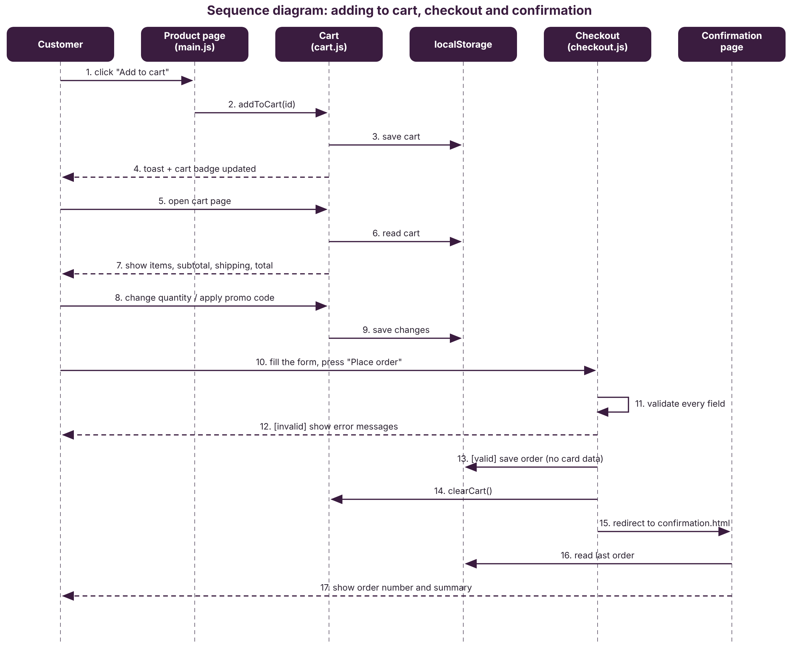

# Part 2 Documentation: Purchase and Validation

Beauty Cosmetics Shop, E-JUST CNC111 project.
This section covers the cart, checkout and confirmation pages, the modified requirements, the Activity and Sequence diagrams, and the Testing section.

---

## 1. Modified Requirements

### 1.1 Functional requirements added by Part 2

| ID | Requirement | Implemented in |
|----|-------------|----------------|
| FR-C1 | The user can add any product to the cart from the home, products and product details pages. | cart.js `addToCart()` |
| FR-C2 | The cart keeps its content when the user moves between pages or reloads the browser (localStorage). | cart.js `getCart()`, `saveCart()` |
| FR-C3 | The header shows how many items are in the cart. | cart.js `updateCartBadge()` |
| FR-C4 | The user can increase, decrease (minimum 1, maximum 10) or remove each cart item and can empty the cart. | cart.html, cart.js |
| FR-C5 | The system calculates subtotal, promo discount, shipping and total automatically. Shipping is 50 EGP and is free when the amount after discount is 1,000 EGP or more. | cart.js `calculateTotals()` |
| FR-C6 | The user can enter the promo code BEAUTY10 for 10% off. Invalid codes are rejected with a message. | cart.js |
| FR-K1 | Checkout collects full name, email, Egyptian mobile number, street address and city. | checkout.html |
| FR-K2 | The user chooses Cash on delivery or Credit / debit card. Card fields appear only for card payment. | checkout.html, checkout.js |
| FR-K3 | Every field is validated; each error is shown under its field and the first wrong field gets focus. | checkout.js `rules` |
| FR-K4 | Card number is checked with the Luhn algorithm, expiry must not be in the past, CVV must have 3 or 4 digits. | checkout.js |
| FR-K5 | A valid order is saved, the cart is emptied and the user is taken to the confirmation page. | checkout.js |
| FR-K6 | The confirmation page shows order number, date, items, totals, delivery details and payment method, and can be printed. | confirmation.html, checkout.js `renderConfirmation()` |
| FR-K7 | Opening checkout with an empty cart shows a message and a link to the products page. | checkout.js |

### 1.2 Non-functional requirements added by Part 2

| ID | Requirement |
|----|-------------|
| NFR-1 | Card details are checked in the browser only. They are never stored or sent anywhere. |
| NFR-2 | User text shown on the confirmation page is escaped so it cannot inject HTML. |
| NFR-3 | Cart, checkout and confirmation pages are responsive (desktop, tablet, phone) and use the same colours, fonts and header/footer as Part 1. |
| NFR-4 | Forms are accessible: every field has a label, errors are announced to screen readers (`aria-live`, `aria-invalid`), all controls work with the keyboard, and there is a "Skip to main content" link. |
| NFR-5 | The site works when opened directly from the files (no server) in current Chrome, Edge, Firefox and Safari. |

### 1.3 Changes to Part 1 requirements

- Product pictures changed from missing .jpg photos to SVG illustrations stored next to the pages, so every product card shows a picture.
- `main.js` now shows a short message and updates the cart badge when "Add to cart" is pressed (through `addToCart()` in cart.js).
- A page icon (favicon), a "Skip to main content" link and a hidden-element rule were added to the shared style.css and to every page.

---

## 2. Diagrams

### 2.1 Activity diagram

### 2.2 Sequence diagram

---

## 3. Testing

### 3.1 Test environment

| Item | Value |
|------|-------|
| How the site was opened | Directly from the files (`index.html`), no server |
| Automated run | Playwright script, Chromium engine (the engine used by Chrome and Edge), 1280x800 desktop and 375x800 phone |
| Manual run still needed | Firefox, Safari (or any WebKit browser), Edge: fill the columns in section 3.3 yourself |

### 3.2 Functional test cases

Result column: Pass = confirmed by the automated Chromium run.

| ID | Test | Steps | Expected result | Chromium |
|----|------|-------|-----------------|----------|
| T1 | Add to cart | Press "Add to cart" on 3 products (one twice) | Message appears, header badge shows 3 | Pass |
| T2 | Cart persists | Reload cart.html | Items are still there | Pass |
| T3 | Quantity change | Press + and - on a line | Quantity and totals update; - disabled at 1 | Pass |
| T4 | Quantity limit | Press + until 10 | + becomes disabled at 10 | Pass |
| T5 | Shipping fee | Cart total 510 EGP | Shipping 50 EGP, total 560 EGP | Pass |
| T6 | Free shipping | Cart total 1,100 EGP | Shipping shows Free | Pass |
| T7 | Valid promo | Enter BEAUTY10 | 10% discount line appears (510 -> -51 EGP) | Pass |
| T8 | Invalid promo | Enter WRONG | "This code is not valid." | Pass |
| T9 | Empty form | Press "Place order" with empty form | 5 field errors, focus on first field | Pass |
| T10 | Bad name / email / phone / address | Enter "M1", "bad@", "12345", "short" | Each field shows its own message | Pass |
| T11 | Invalid card number | 4242 4242 4242 4241 | "This card number is not valid." | Pass |
| T12 | Expired card | Expiry 01/20 | "This card has expired." | Pass |
| T13 | Bad CVV | CVV 12 | "CVV has 3 or 4 digits." | Pass |
| T14 | Card fields toggle | Choose Cash on delivery | Card fields hidden | Pass |
| T15 | Successful order (card) | Fill valid data with card 4242 4242 4242 4242, expiry 08/28, CVV 123 | Redirect to confirmation, order number shown | Pass |
| T16 | Successful order (cash) | Fill valid data, Cash on delivery | Redirect to confirmation, no card fields needed | Pass |
| T17 | Cart emptied after order | Go back to the home page | Badge hidden, cart empty | Pass |
| T18 | Empty checkout | Open checkout.html with empty cart | "Nothing to check out yet" message | Pass |
| T19 | Confirmation without order | Open confirmation.html directly with no order | "No recent order" message | Pass |
| T20 | Product filter and search | products.html?category=Skincare, then search "zzz" | 4 skincare products, then "No products match" message | Pass |
| T21 | Phone layout | Open products.html at 375 px wide (cart view checked in the screenshot) | No sideways scrolling | Pass |

Test card number 4242 4242 4242 4242 passes the Luhn check and is only for testing.

### 3.3 Cross-browser compatibility checklist

Open the site in each browser and fill each row. Write Pass or the problem you found.

| Check | Chrome | Edge | Firefox | Safari | Phone browser |
|-------|--------|------|---------|--------|---------------|
| Pages load and layout looks correct | Pass (engine tested) | | | | |
| Header, footer and grid look the same | Pass (engine tested) | | | | |
| Add to cart and badge update (T1) | Pass (engine tested) | | | | |
| Cart quantity buttons and promo (T3, T7) | Pass (engine tested) | | | | |
| Checkout validation messages (T9-T13) | Pass (engine tested) | | | | |
| Card number and expiry auto-formatting | Pass (engine tested) | | | | |
| Order placed, confirmation shown (T15) | Pass (engine tested) | | | | |
| Print order button | | | | | |

"Pass (engine tested)" means the Chromium engine was tested by script. Chrome and Edge use the same engine, but please still open them once and confirm.

### 3.4 Screenshots

| Page | File |
|------|------|
| Cart (desktop) | cart.png |
| Checkout with validation errors | checkout-errors.png |
| Checkout filled with valid data | checkout-filled.png |
| Order confirmation | confirmation.png |
| Cart on a phone | cart-mobile.png |
| Products on a phone | products-mobile.png |

### 3.5 Known limitations

- This is a front-end only project: orders are saved in the browser (localStorage) of the visitor, not on a server, and no real payment or email is sent.
- Google Fonts need an internet connection; without it the browser uses fallback fonts (Georgia and Segoe UI/Arial) and the layout stays the same.
